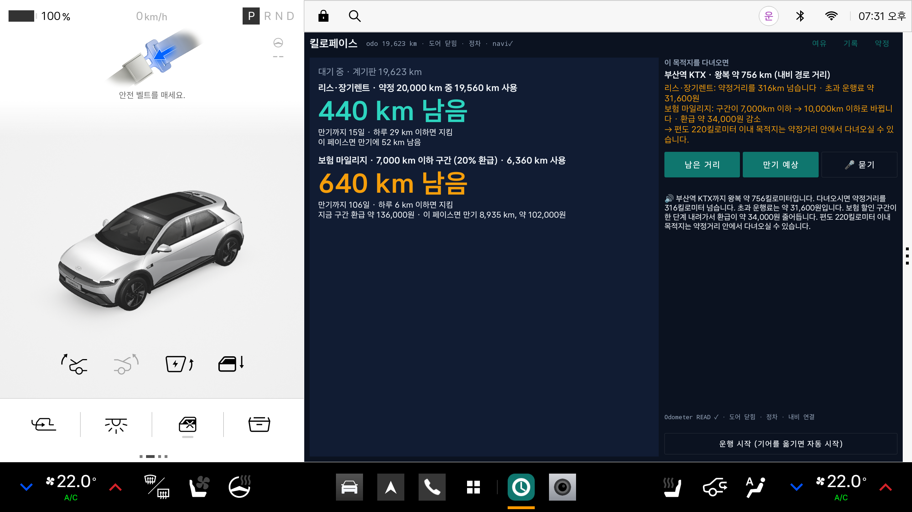
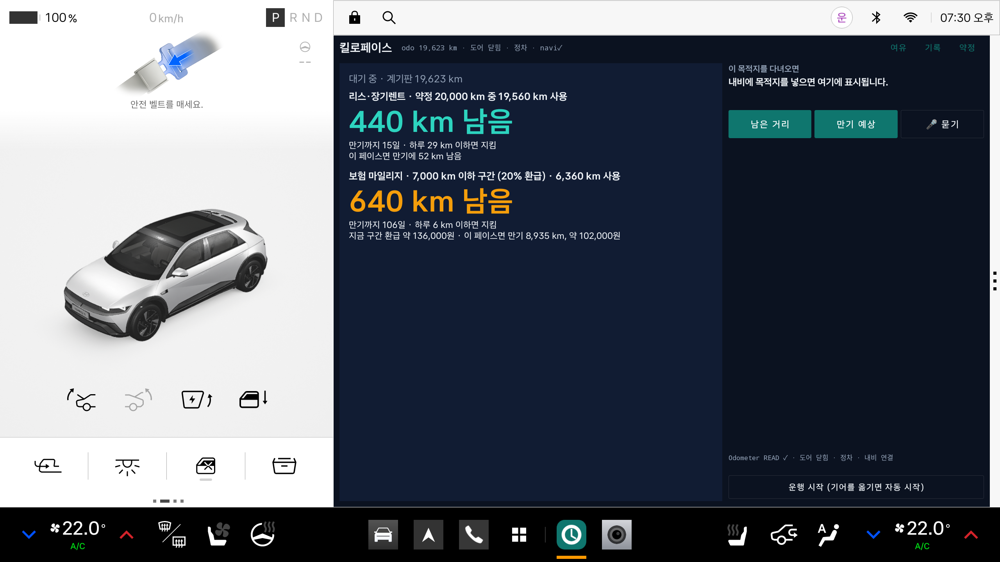
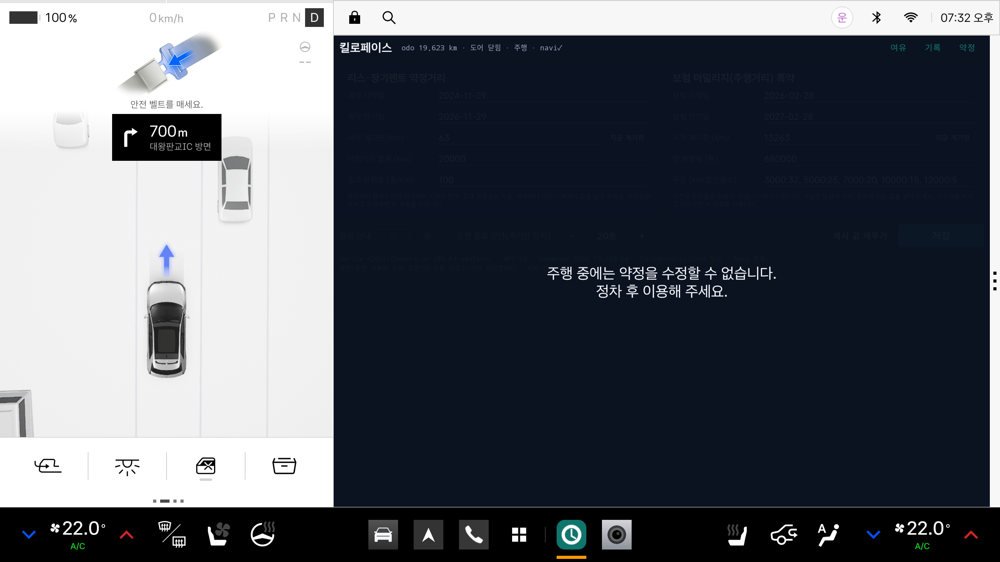
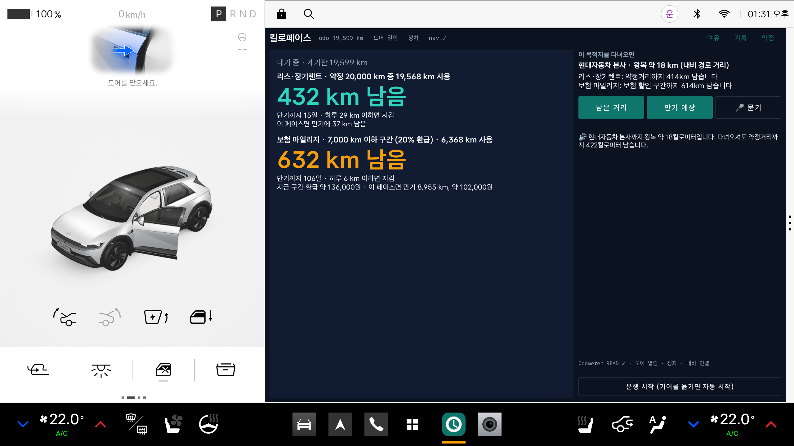
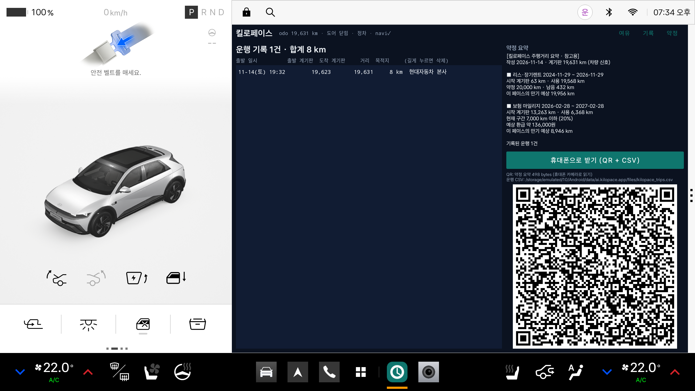
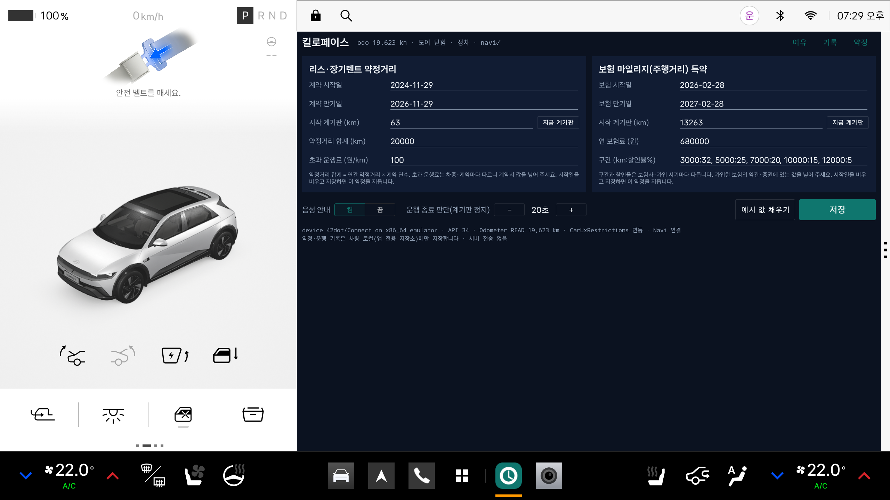
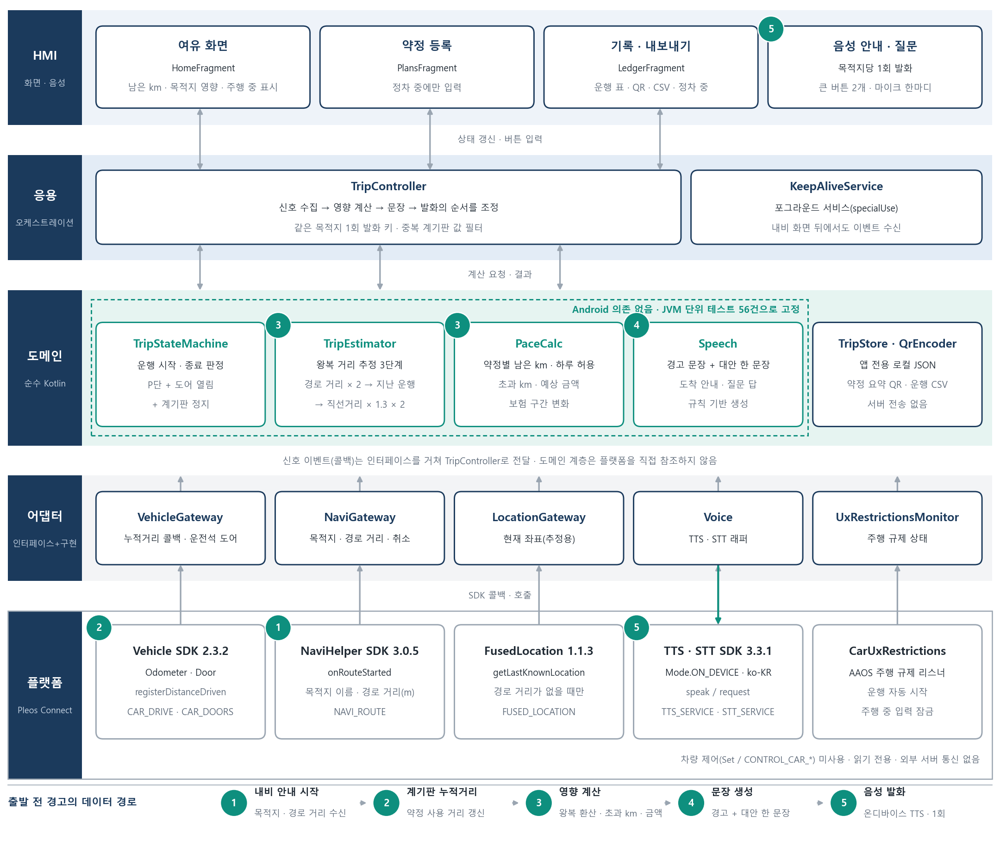

# 킬로페이스 (KiloPace) — 목적지를 넣는 순간, 약정거리를 넘는지 차가 먼저 말한다

> 리스·장기렌트 약정거리와 보험 마일리지(주행거리) 특약 구간을 등록해 두면,
> 내비에 목적지를 넣는 순간 "다녀오면 약정을 넘는지"를 차가 먼저 말해 주는 Pleos Connect 차량용 앱.

2026 현대자동차그룹 차량용 앱 개발 공모전(Pleos App Market) 출품작



| 항목 | 내용 |
|---|---|
| 플랫폼 | Pleos Connect (Android Automotive OS), minSdk 28 · targetSdk 35 |
| 언어·구조 | Kotlin, XML 뷰, 5계층(HMI · 응용 · 도메인 · 어댑터 · 플랫폼) |
| 사용 SDK | Vehicle SDK 2.3.2, NaviHelper SDK 3.0.5, TTS·STT SDK 3.3.1, FusedLocation 1.1.3, AAOS CarUxRestrictions |
| 검증 | JVM 단위 테스트 56건 통과, Pleos Connect Emulator 종단 시나리오 실측 |
| 배포물 | 서명된 release APK(R8) [`apk/`](apk/), 사용 설명서 [`docs/MANUAL.md`](docs/MANUAL.md) |
| 데이터 | 차량 로컬 저장만 사용. 서버 전송·로그인·분석 SDK 없음 |

---

## 무엇을 하는 앱인가

- **약정거리**: 리스·장기렌트 계약 기간에 달릴 수 있는 총 거리. 넘으면 km당 초과 운행료를 낸다.
- **마일리지 특약 구간**: 자동차보험에서 연간 주행거리가 짧을수록 보험료를 더 돌려받는 단계표.

둘 다 계기판 누적거리로 정산되는데, 결과는 반납·만기 정산 때 알게 된다. 그때는 달린 거리를 되돌릴 수 없다. 넘길지 말지를 바꿀 수 있는 순간은 목적지를 넣고 출발하기 전이다. 킬로페이스는 그 순간에 계기판 값(Vehicle SDK)과 내비가 계산한 경로 거리(NaviHelper SDK)를 합쳐 한 번 말한다.

## 어떤 문제를 어떻게 푸는가

| 문제 | 킬로페이스의 해결 |
|---|---|
| 약정까지 남은 거리를 계약서와 계기판을 보고 직접 계산해야 한다 | 약정을 한 번 등록하면 계기판 누적거리를 차에서 읽어 남은 km와 하루 허용 km를 큰 숫자로 보여 준다 |
| 장거리 한 번이 약정을 넘기는지 출발 전에 알 수 없다 | 내비에 목적지를 넣으면 경로 거리를 왕복으로 환산해 몇 km 넘고 얼마가 드는지 음성으로 한 번 말한다 |
| 초과 사실을 반납·정산 때 처음 안다 | 출발 전 경고에 더해 지금 페이스의 만기 예상을 보여 주고, 대안 한 문장(편도 몇 km 이내는 가능, 하루 몇 km 이하면 지킴)을 덧붙인다 |
| 운전 중에는 계산도 조회도 할 수 없다 | 운전자가 입력할 것이 없다. 차가 먼저 말하고, 물을 때는 큰 버튼 2개나 음성 한마디면 된다 |

## 핵심 장면 (에뮬레이터 실측, 2026-11-15)

계기판 19,560km. 리스 약정 20,000km(남음 440km, 만기 15일), 보험 7,000km 이하 구간(남음 640km). 내비에 「부산역 KTX」 안내를 시작하면 앱이 편도 378km를 받아 왕복 756km로 환산하고, 내비 화면 뒤에 가려진 상태에서 말한다.

> "부산역 KTX까지 왕복 약 756킬로미터입니다. 다녀오시면 약정거리를 316킬로미터 넘습니다. 초과 운행료는 약 31,600원입니다. 보험 할인 구간이 한 단계 내려가서 환급이 약 34,000원 줄어듭니다. 편도 220킬로미터 이내 목적지는 약정거리 안에서 다녀오실 수 있습니다."
>
> 넘는 목적지에는 약정 안에서 다녀올 수 있는 편도 거리를, 넘지 않는 목적지에는 다녀온 뒤 만기까지 지켜야 할 하루 거리를 이어서 말한다.

이어서 23km를 달리고 P단에서 운전석 문을 열면 한 줄로 끝낸다.

> "이번 운행은 23킬로미터였습니다. 약정거리까지 417킬로미터, 만기까지 15일 남았습니다. 하루 28킬로미터 이하로 달리시면 지킬 수 있습니다."

초과 운행료 100원/km, 연 보험료 68만 원, 구간표는 시연용 **예시값**이다. 실제 값은 계약서·보험 증권마다 다르다.

## 화면

| 여유 화면 (주행 중에도 표시) | 출발 전 경고 | 주행 중 입력 잠금 |
|---|---|---|
|  |  |  |

| 도착 안내 | 기록 · 약정 요약 QR | 약정 등록 (정차 중에만) |
|---|---|---|
|  |  |  |

화면의 금액과 구간은 시연용 예시값이다.

## 기능

| # | 기능 | 동작 | 쓰는 신호 |
|---|---|---|---|
| F1 | 약정 등록 (정차 중에만) | 계약 시작·만기일, 시작 계기판(「지금 계기판」 버튼으로 차량 값 그대로), 약정거리 합계·초과 운행료(원/km) 또는 연 보험료·구간표(`km:할인율`). 종류별 1건씩 차량 로컬 JSON에 저장 | Odometer, CarUxRestrictions |
| F2 | 여유 화면 (주행 중에도 표시) | 약정별 남은 km(큰 숫자), 만기까지 일수, 하루 허용 km, 지금 페이스의 만기 예상(초과 km·예상 초과 운행료 / 예상 환급액). 상태 색 3단계(여유·빠듯·초과) | Odometer 콜백 |
| F3 | 출발 전 경고 (핵심) | 내비 안내가 시작되면 목적지 이름과 경로 거리(편도)를 받아 왕복으로 환산 → 약정별 영향 계산 → TTS로 한 번. 같은 목적지는 한 번만 말한다 | NaviHelper `onRouteStarted`, Odometer, TTS, FusedLocation |
| F4 | 운행 자동 기록·도착 안내 | 기어가 P를 벗어나 주행 규제가 걸리면 운행 시작(출발 계기판 기록). P단 + 운전석 도어 열림 + 계기판 정지(설정 시간, 기본 20초) 3조건으로 종료하고 묻지 않고 짧게 말한다 | CarUxRestrictions, Door, Odometer, TTS |
| F5 | 질문 | 큰 버튼 「남은 거리」「만기 예상」 또는 「🎤 묻기」(한마디, 못 알아들으면 남은 거리로 답) | STT, TTS |
| F6 | 기록·내보내기 (정차 중에만) | 운행 표(출발·도착 계기판, 거리, 목적지), 약정 요약 QR(휴대폰 카메라로 읽는 텍스트, "참고용" 표기), 운행 CSV(UTF-8 BOM) | CarUxRestrictions |

왕복 거리의 근거는 세 단계이고 화면에 항상 표시한다.

1. 내비 경로 거리 × 2 → "내비 경로 거리"
2. 경로 거리가 없으면 같은 목적지의 지난 운행 평균 × 2 → "지난 운행 평균"
3. 그것도 없으면 현재 위치~목적지 직선거리 × 1.3 × 2 → "직선거리 기준 추정"

| 여유 화면 | 주행 중 잠금 | 도착 안내 |
|---|---|---|
|  |  |  |

| 기록·QR | 약정 등록 |
|---|---|
|  |  |

### 내비 화면 뒤에서도 말하는 이유

에뮬레이터에서 앱이 내비 뒤로 가면 시스템이 프로세스를 멈춰(freeze) 이벤트가 앱을 다시 열 때까지 밀리는 것을 실측으로 발견했다. 포그라운드 서비스(`KeepAliveService`, `specialUse`)로 프로세스를 살려 두었고, 이후 가려진 상태에서 경고가 발화되는 것을 logcat(`KiloPace/Trip` 태그의 `say:` 줄)으로 확인했다. 이 서비스는 앱 화면이 한 번 보일 때 시작된다.

## 사용 SDK

| SDK | 버전 | 용도 | 퍼미션 |
|---|---|---|---|
| Vehicle | 2.3.2 | Odometer(콜백·즉시 조회): 약정 사용 거리, 출발·도착 계기판 / Door(운전석): 운행 종료 판단 | `CAR_DRIVE` `CAR_DOORS` `CAR_INFO` `CAR_SEATS` |
| NaviHelper | 3.0.5 | `onRouteStarted`의 목적지 이름·경로 거리, 목적지·현재 위치 정보 | `NAVI_ROUTE` |
| TextToSpeech | 3.3.1 | 경고, 도착 안내, 질문 답 (ON_DEVICE, ko-KR) | `TTS_SERVICE` |
| SpeechToText | 3.3.1 | 질문 한마디 (ON_DEVICE) | `STT_SERVICE` `RECORD_AUDIO` |
| FusedLocation | 1.1.3 | 내비 현재 위치가 없을 때 직선거리 추정용 좌표 | `FUSED_LOCATION` |
| AAOS | — | `CarUxRestrictionsManager`: 운행 자동 시작, 주행 중 입력 잠금 | — |

그 밖에 Android `FOREGROUND_SERVICE`(specialUse)와 `POST_NOTIFICATIONS`를 쓴다. 차량 제어 API와 경로 요청 API는 쓰지 않는다.

## 빌드·설치·실행

요구: JDK 17, Android SDK 35(또는 Android Studio), Pleos Connect Emulator.

```bash
gradlew assembleDebug        # app/build/outputs/apk/debug/app-debug.apk
gradlew assembleRelease      # R8 적용. keystore/keystore.properties 가 없으면 unsigned
gradlew testDebugUnitTest    # JVM 단위 테스트 56건
```

제출용 서명 APK는 [`apk/드라AI브_KiloPace_release.apk`](apk/)에 있다.

```bash
adb install -r -g apk/드라AI브_KiloPace_release.apk
adb shell am start -n ai.kilopace.app/.ui.MainActivity
```

`-g`는 마이크·알림 권한을 설치 시 허용한다. 앱을 한 번 열면 포그라운드 서비스가 시작되어 이후 내비 화면 뒤에서도 동작한다.

폴더 경로에 한글이 있으면 빌드 경로 검사와 테스트 러너에서 문제가 날 수 있다. 그런 경우 `subst S: <상위 폴더>`로 영문 드라이브를 만들어 `S:\kilopace`에서 실행한다.

## 시연 재현 (Virtual Console, 약 5분)

Virtual Console: `adb forward tcp:8088 tcp:8088` 후 브라우저에서 `http://127.0.0.1:8088`

1. **계기판 넣기** — Virtual Console에서 Odometer를 `19560`으로 둔다. 기어는 P, 운전석 도어는 닫힘.
2. **약정 등록** — 앱의 「약정」 탭 → 「예시 값 채우기」 → 「저장」. 지금 계기판을 기준으로 "리스 만기 15일 전·약정거리까지 440km, 보험 7,000km 이하 구간·640km 남음" 상황이 만들어진다. 계약 시작일은 과거 날짜로 채워진다(시연용).
3. **여유 화면** — 「여유」 탭에서 남은 km, 만기까지 일수, 하루 허용 km를 확인한다.
4. **출발 전 경고** — 에뮬레이터 내비에서 먼 목적지(실측에서는 「부산역 KTX」)를 검색해 안내를 시작한다. 내비 화면이 앞에 있는 채로 경고가 들린다. 앱으로 돌아오면 「이 목적지를 다녀오면」 칸에 왕복 거리와 근거, 약정별 영향이 보인다. 편도 거리는 에뮬레이터 현재 위치에 따라 달라진다(실측 378km).
5. **주행** — Virtual Console에서 기어를 D로 옮긴다. 운행이 자동으로 시작되고 「기록」「약정」 탭이 잠긴다. Odometer를 `19583`으로 올린다(+23km).
6. **도착** — 기어를 P로, 운전석 도어(Front left)를 Open으로 둔다. 계기판이 20초 동안 그대로면 도착 안내이 들린다. 기다리지 않으려면 「도착 · 운행 종료」 버튼을 누른다.
7. **질문** — 「남은 거리」「만기 예상」 버튼. (에뮬레이터는 마이크 입력이 없어 「🎤 묻기」는 "음성 입력이 없어 남은 거리로 답했습니다"로 끝난다.)
8. **기록·QR** — 도어를 닫고 「기록」 탭 → 운행 표 확인 → 「휴대폰으로 받기 (QR + CSV)」.

음성을 확인하기 어려운 환경이면 `adb logcat -s KiloPace/Trip`에서 `say:` 줄을 보거나, 「여유」 화면의 🔊 줄(마지막으로 말한 문장)을 본다.

## 테스트

```bash
gradlew testDebugUnitTest
```

계산·문장·상태 기계는 Android 의존이 없는 순수 Kotlin이라 JVM에서 돈다. 총 56건.

| 파일 | 건수 | 범위 |
|---|---|---|
| `data/PaceCalcTest.kt` | 18 | 약정 계산(남은 km, 하루 허용 km, 만기 예상, 초과 운행료, 보험 구간·환급, 구간표 파싱) |
| `data/SpeechTest.kt` | 21 | 경고·도착·질문 문장, 왕복 거리 추정 3단계, 음성 질문 분류, 요약·CSV 내보내기 |
| `trip/TripStateMachineTest.kt` | 12 | 운행 상태 기계(도어·정차·계기판 정지 조합, 도착 이벤트, 버튼, 쿨다운) |
| `data/QrEncoderTest.kt` | 2 | QR 인코딩 |

## 아키텍처



| 계층 | 구성 요소 | 책임 |
|---|---|---|
| HMI | `HomeFragment`, `PlansFragment`, `LedgerFragment`, 음성 안내 | 주행 중에는 큰 숫자와 큰 버튼만 보여 주고, 입력 화면은 정차 중에만 연다 |
| 응용 | `TripController`, `KeepAliveService` | 신호 수집 → 영향 계산 → 문장 → 발화의 순서를 조정한다. 같은 목적지는 한 번만 말한다 |
| 도메인 | `TripStateMachine`, `TripEstimator`, `PaceCalc`, `Speech`, `TripStore` | 운행 판정, 왕복 거리 추정, 약정 계산, 문장 생성. Android 의존이 없는 순수 Kotlin이라 JVM 단위 테스트로 고정했다 |
| 어댑터 | `VehicleGateway`, `NaviGateway`, `LocationGateway`, `Voice`, `UxRestrictionsMonitor` | Pleos SDK를 인터페이스 뒤에 둔다. 도메인 계층은 플랫폼을 직접 참조하지 않는다 |
| 플랫폼 | Vehicle SDK, NaviHelper SDK, FusedLocation, TTS·STT SDK, CarUxRestrictions | 읽기 전용으로만 쓴다. 차량 제어(Set / CONTROL_CAR_*) API는 쓰지 않는다 |

**출발 전 경고의 데이터 경로**

1. 내비 안내 시작: `onRouteStarted`로 목적지 이름과 경로 거리(m)를 받는다.
2. 계기판 누적거리: Odometer 콜백으로 약정 사용 거리를 갱신한다.
3. 영향 계산: 경로 거리를 왕복으로 환산하고 약정별 초과 km와 예상 금액, 보험 구간 변화를 계산한다.
4. 문장 생성: 경고 문장에 대안 한 문장을 붙인다.
5. 음성 발화: 온디바이스 TTS로 목적지당 한 번 말한다.

**설계에서 지킨 것**

- 계산·문장·상태 기계를 플랫폼에서 떼어 냈다. 에뮬레이터 없이도 56건의 테스트로 동작을 확인할 수 있다.
- 왕복 거리의 근거를 3단계(내비 경로 거리 → 같은 목적지의 지난 운행 평균 → 직선거리 추정)로 두고, 화면에 어느 근거인지 항상 표시한다.
- 앱이 내비 화면 뒤로 가도 이벤트를 받도록 포그라운드 서비스를 둔다.
- 약정과 운행 기록은 차량 로컬에만 저장한다. 밖으로 나가는 경로는 사용자가 정차 중 직접 띄우는 QR과 CSV뿐이다.

## 프로젝트 구조

```
app/src/main/java/ai/kilopace/app
├─ KiloPaceApp.kt        Application: 게이트웨이·컨트롤러 조립
├─ KeepAliveService.kt   포그라운드 서비스(specialUse): 내비 뒤에서도 이벤트 수신
├─ data/    Plan(약정 모델·PaceCalc 계산기), Speech(왕복 추정·문장·질문 분류),
│           TripRecord, TripStore(운행·약정 로컬 JSON, 설정, 요약·CSV), QrEncoder
├─ signal/  Gateways(인터페이스), PleosVehicleGateway(Odometer·Door),
│           PleosNaviGateway(경로 시작·목적지·현재 위치), PleosLocationGateway
├─ trip/    TripStateMachine(순수 Kotlin), TripController(신호 → 계산 → 저장 → 화면·음성)
├─ voice/   Voice(TTS·STT, ON_DEVICE)
├─ ux/      UxRestrictionsMonitor(AAOS CarUxRestrictions)
└─ ui/      MainActivity, HomeFragment(여유), LedgerFragment(기록), PlansFragment(약정)
app/src/test/java/ai/kilopace/app   단위 테스트 4개 파일
apk/                                서명된 release APK
docs/MANUAL.md                      사용 설명서
docs/screens/                       에뮬레이터 화면 6장
docs/architecture.png               시스템 아키텍처 그림
```

Kotlin, minSdk 28, targetSdk 35, XML 뷰, release는 R8 적용.

## 한계

- **약정 값은 사용자가 직접 입력한다.** 약정거리, 초과 운행료, 보험료, 구간표는 계약서·증권을 보고 넣어야 한다. 금액은 그 입력값으로 계산한 참고값이다. 보험사의 연 환산·정산 방식과 다를 수 있다.
- **왕복 거리는 경로 거리 × 2로 추정한다.** 다른 길로 돌아오면 실제와 다르다.
- **에뮬레이터에서만 검증했다.** 실차에서는 검증하지 못했다.
- **앱을 한 번 열어야 포그라운드 서비스가 시작된다.** 부팅 시 자동 시작은 구현하지 않았다.
- **마이크 입력(STT)은 에뮬레이터에서 검증하지 못했다.** AVD에 마이크 입력이 없어 질문 기능은 버튼으로 시연했다.
- 에뮬레이터는 차량이 경로를 따라 움직이지 않아 내비 도착 이벤트(`onDestinationArrived`)가 오지 않는다. 운행 종료는 3조건 또는 「도착」 버튼으로 확인했다.
- 약정은 종류별 1건(리스·장기렌트 1, 보험 1)이다.

## 선례와 이 앱이 다른 점

새롭지 않은 것부터 적는다.

- **주행거리 자동 전달은 이미 있다.** 현대·기아 커넥티드카는 동의하면 누적 주행거리가 보험사로 전달되어 계기판 사진 제출이 필요 없다고 안내된다([뱅크샐러드 안내 글](https://www.banksalad.com/articles/자동차보험-할인-특약), [참고 글](https://wikidocs.net/blog/@knarchive/21522/)). 이것은 가입·정산용 조회다.
- **폰 앱도 누적거리를 받을 수 있다.** 현대 디벨로퍼스와 [Pleos Vehicle Data API](https://document.pleos.ai/api-reference/vehicle-data-api/getting-started/call-api)가 동의 기반으로 누적거리를 제3자 서비스에 준다. 남은 거리 계산은 차 안에서만 되는 일이 아니다.
- **리스 주행거리 페이스 앱이 해외에 있다.** [Lease Limit](https://apps.apple.com/us/app/lease-limit/id6477562872), [LeaseTrack](https://apps.apple.com/us/app/lease-track/id1632037291) 등. 사용자가 계기판 숫자를 직접 입력하는 폰 앱이다.
- **마이현대(블루링크)는 월간 리포트로 주행 정보를 보여 준다**([안내](https://www.hyundai.com/kr/ko/digital-customer-support/app/myhyundai/bluelink/smart-driving)).

국내 보험사 앱·블루링크에 "구간을 넘기 전 경고"가 있는지는 검색으로는 찾지 못했고, 보험사 앱 내부 화면까지는 확인하지 못했다. 그래서 "최초"나 "없다"고 말하지 않는다.

이 앱이 좁혀서 내세우는 차이는 하나다. **정산 전에, 출발 전에 알려 준다.** 넘길지 말지를 바꿀 수 있는 순간은 목적지를 넣는 때이고, 그 순간에 계기판 값과 목적지(경로 거리)를 함께 갖고 운전자에게 말을 걸 수 있는 자리가 차 안이다.

참고한 공개 수치: 현대캐피탈 신차 리스·렌트 초과 운행 부담금 "km당 80~200원, 차종별 상이"([안내](https://www.hyundai.com/kr/ko/event/event-hyundai-ev-standard-rent-lease-2509)), 2025년 주행거리 특약 가입률 88.4%·환급 비율 66%·평균 환급 13만 3천 원(보험개발원 분석 인용 [보도](https://www.heraldk.com/article/2026042019000051922)).

## 개인정보

- 약정 값과 운행 기록은 차량 로컬(앱 전용 저장소의 `plans.json`, `trips.json`)에만 저장한다.
- 서버 전송, 로그인, 분석 SDK가 없다. 네트워크로 보내는 코드가 없다.
- 밖으로 나가는 경로는 사용자가 정차 중 직접 띄우는 QR과 CSV 파일뿐이다. QR은 "참고용" 요약이며 보험사·렌트사 제출 서류를 대신하지 않는다.

## 경과

10/26부터 Pleos SDK 신호 검증(Odometer 콜백, 도어, 내비 정보)과 운행 감지 상태 기계, 음성, QR·CSV, 주행 중 잠금을 만들었다. 그 위에 약정 계산과 왕복 추정, 출발 전 경고와 대안 문장, 내비 경로 거리 연동, 포그라운드 서비스를 구현했고, 11/15에 에뮬레이터 종단 실측과 단위 테스트 56건 통과를 확인했다.
