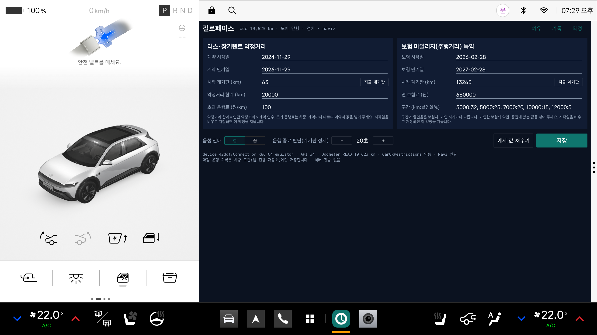
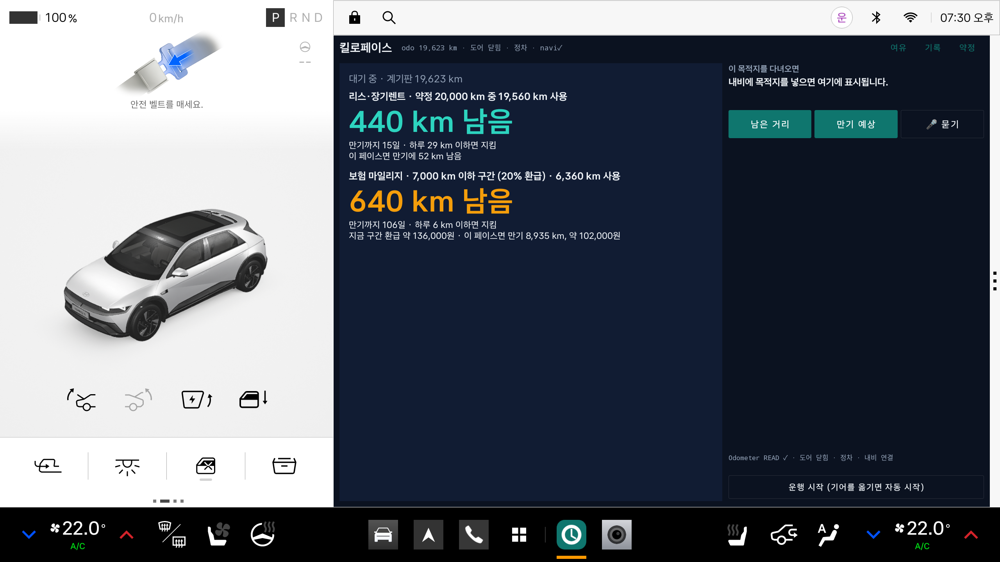
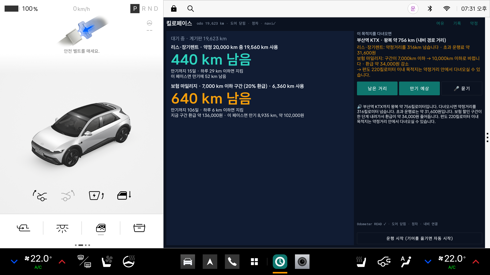
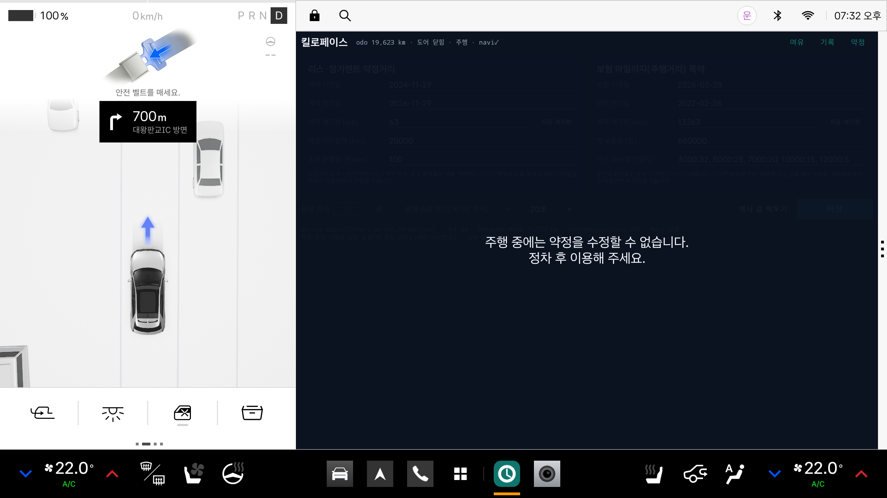
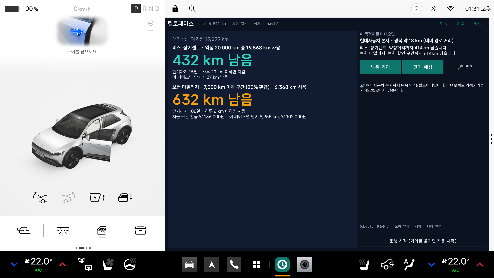
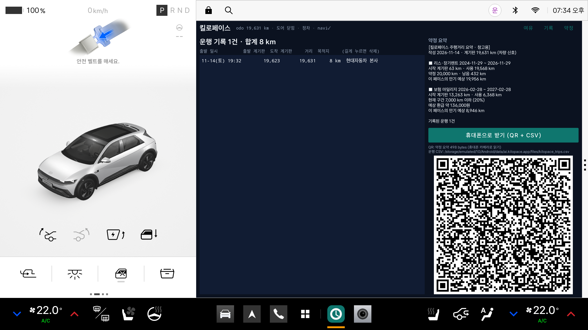

# 킬로페이스 사용 설명서

킬로페이스는 리스·장기렌트 약정거리와 보험 마일리지(주행거리) 특약 구간을 등록해 두면, 내비에 목적지를 넣는 순간 "다녀오면 약정을 넘는지"를 말해 주는 앱이다. 화면은 「여유」「기록」「약정」 세 탭이다.

- **약정거리**: 리스·장기렌트 계약 기간에 달릴 수 있는 총 거리. 넘으면 km당 초과 운행료를 낸다.
- **마일리지 특약 구간**: 연간 주행거리가 짧을수록 보험료를 더 돌려받는 단계표.

## 1. 설치와 첫 실행

```bash
adb install -r -g apk/드라AI브_KiloPace_release.apk
adb shell am start -n ai.kilopace.app/.ui.MainActivity
```

앱을 한 번 열어야 한다. 이때 포그라운드 서비스가 시작되어, 이후 내비 화면이 앞에 있어도 목적지 경고와 도착 안내가 나온다. 차량을 다시 켠 뒤에는 앱을 한 번 다시 열어야 한다(부팅 자동 시작 미구현).

## 2. 화면별 사용법

### 「약정」 탭 — 정차 중에만 열림



| 칸 | 넣는 값 |
|---|---|
| 계약 시작일·만기일 | `2026-11-30` 형식 |
| 시작 계기판 (km) | 계약을 시작한 때의 계기판. 오늘 시작이면 「지금 계기판」 버튼이 차량 값을 그대로 넣는다 |
| 약정거리 합계 (km) | 연간 약정거리 × 계약 연수 |
| 초과 운행료 (원/km) | 계약서 값 |
| 연 보험료 (원) | 보험 증권 값 |
| 구간 (km:할인율%) | 예: `3000:32, 5000:25, 7000:20`. 가입한 보험의 약관·증권 값 |

- 리스·장기렌트 1건, 보험 1건을 등록할 수 있다. 한쪽만 써도 된다.
- 시작일을 비우고 저장하면 그 약정을 지운다.
- 「음성 안내」 켬/끔, 「운행 종료 판단(계기판 정지)」 시간(기본 20초, 실차에서는 더 길게 권장)을 여기서 바꾼다.
- 「예시 값 채우기」는 시연용 값을 채운다. 금액과 구간은 실제 계약이 아닌 예시다.
- 「저장」을 눌러야 반영된다.
- 주행 중에는 "주행 중에는 약정을 수정할 수 없습니다"로 잠긴다.

### 「여유」 탭 — 주행 중에도 표시



- 약정별로 **남은 km**가 큰 숫자로 보인다. 색은 여유·빠듯(지금 페이스면 만기에 넘음)·초과 3단계다.
- 그 아래에 만기까지 일수, 하루 허용 km, 지금 페이스의 만기 예상(리스: 초과 km와 예상 초과 운행료 / 보험: 예상 환급액)이 나온다.
- **「이 목적지를 다녀오면」** 칸: 내비에 목적지를 넣으면 왕복 거리, 그 근거(내비 경로 거리 / 지난 운행 평균 / 직선거리 기준 추정), 약정별 영향이 나온다. 같은 내용을 음성으로 한 번 말한다.
- 🔊 줄에는 앱이 마지막으로 말한 문장이 남는다.
- 「남은 거리」「만기 예상」 버튼을 누르면 음성으로 답한다. 「🎤 묻기」는 한마디를 듣고 답하며, 못 알아들으면 남은 거리로 답한다.
- 「운행 시작」은 누르지 않아도 된다. 기어를 P에서 옮기면 자동으로 시작된다. 운행 중에는 「도착 · 운행 종료」 버튼으로 바뀐다.



### 운행의 시작과 끝

- 시작: 기어가 P를 벗어나 주행 규제가 걸리면 그때의 계기판을 출발값으로 기록한다.
- 끝: **P단 + 운전석 도어 열림 + 계기판이 설정 시간 동안 그대로**, 세 조건이 모두 맞으면 운행을 닫고 짧게 말한다. 묻지 않는다. 바로 끝내려면 「도착 · 운행 종료」를 누른다.
- 움직인 거리가 0이면 기록하지 않는다.




### 「기록」 탭 — 정차 중에만 열림



- 운행 표: 출발 일시, 출발 계기판, 도착 계기판, 거리, 목적지. 행을 길게 누르면 삭제할 수 있다.
- 약정 요약: 지금 계기판 기준의 약정별 사용·남은 거리와 금액.
- 「휴대폰으로 받기 (QR + CSV)」: 약정 요약을 QR로 띄우고 운행 CSV 파일을 저장한다. QR은 휴대폰 카메라로 읽는 텍스트이며 "참고용"이다. 보험사·렌트사 제출 서류를 대신하지 않는다.

## 3. 심사자용: 에뮬레이터에서 5분 안에 확인하는 순서

준비: Pleos Connect Emulator 실행, APK 설치, 앱 한 번 열기. Virtual Console은 `adb forward tcp:8088 tcp:8088` 후 `http://127.0.0.1:8088`.

| 순서 | 조작 | 확인할 것 |
|---|---|---|
| 1 | Virtual Console: Odometer `19560`, 기어 P, 운전석 도어 닫힘 | 앱 위쪽 상태 줄에 `odo 19,560 km · 정차` |
| 2 | 「약정」 → 「예시 값 채우기」 → 「저장」 | "저장했습니다" |
| 3 | 「여유」 탭 | 리스 **440 km 남음**, 만기까지 15일 / 보험 7,000 km 이하 구간, **640 km 남음** |
| 4 | 에뮬레이터 내비에서 먼 목적지(예: 부산역 KTX)를 검색해 안내 시작. 앱으로 돌아오지 않는다 | 내비 화면 위에서 경고 음성. 실측 문장: "부산역 KTX까지 왕복 약 756킬로미터입니다. 다녀오시면 약정거리를 316킬로미터 넘습니다. 초과 운행료는 약 31,600원입니다. 보험 할인 구간이 한 단계 내려가서 환급이 약 34,000원 줄어듭니다. 편도 220킬로미터 이내 목적지는 약정거리 안에서 다녀오실 수 있습니다." |
| 5 | 앱으로 돌아와 「여유」 탭 | 「이 목적지를 다녀오면」 칸에 왕복 거리 (내비 경로 거리)와 약정별 영향. 🔊 줄에 말한 문장 |
| 6 | Virtual Console: 기어 D → Odometer `19583` | "운행 중", 이번 운행 23 km. 「기록」「약정」 탭이 잠김 |
| 7 | 기어 P → 운전석 도어(Front left) Open → 20초 대기 | "이번 운행은 23킬로미터였습니다. 약정거리까지 417킬로미터, 만기까지 15일 남았습니다. 하루 28킬로미터 이하로 달리시면 지킬 수 있습니다." |
| 8 | 「남은 거리」, 「만기 예상」 버튼 | 음성 답 |
| 9 | 도어 닫기 → 「기록」 → 「휴대폰으로 받기 (QR + CSV)」 | 운행 1건(19,560 → 19,583, 23 km, 목적지), QR 표시 |

참고

- 4번의 편도 거리는 에뮬레이터의 현재 위치에 따라 달라지므로 숫자가 위 문장과 다를 수 있다. 계산식은 같다(왕복 = 편도 × 2, 초과 km = 왕복 − 남은 km, 초과 운행료 = 초과 km × 100원).
- 소리를 듣기 어려우면 `adb logcat -s KiloPace/Trip`에서 `say:` 줄을 본다.
- 같은 목적지로는 다시 말하지 않는다. 다시 들으려면 안내를 취소하고 다른 목적지로 시작한다.
- 에뮬레이터에는 마이크 입력이 없어 「🎤 묻기」는 "음성 입력이 없어 남은 거리로 답했습니다"로 끝난다.
- 예시 값의 초과 운행료(100원/km), 연 보험료(68만 원), 구간표는 시연용이다.

## 4. 알아 둘 한계

- 약정 값은 직접 입력해야 하고, 금액은 입력값으로 계산한 참고값이다. 보험사의 정산 방식과 다를 수 있다.
- 왕복 거리는 경로 거리 × 2 추정이다. 다른 길로 돌아오면 다르다.
- 에뮬레이터에서만 검증했고 실차에서는 검증하지 못했다.
- 앱을 한 번 열어야 뒤에서 동작한다(부팅 자동 시작 미구현).
- 마이크 입력은 에뮬레이터에서 검증하지 못했다.

## 5. 개인정보

약정 값과 운행 기록은 차량 로컬에만 저장한다. 서버 전송과 로그인이 없다. 밖으로 나가는 것은 사용자가 정차 중 직접 띄운 QR과 CSV뿐이다.
